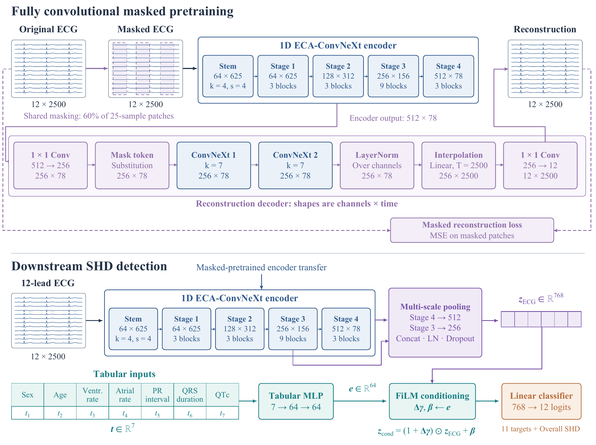

# ECG-FCMAE

**Fully convolutional masked pretraining for ECG-based structural heart disease screening.**

本仓库整理了论文对应的模型、训练与分析代码、可复现配置、冻结结果和中英文 LaTeX 稿件。代码以正式实验使用的 `20260731_noaug_v1` 源码快照为基础；目录名中的 `noaug` 是快照名称，论文下游训练实际使用 `jitter0.05,mask0.1` 增强。

[复现指南](docs/reproduction.md) · [结果与论文对应关系](docs/results_map.md) · [来源与整理记录](docs/provenance.md) · [论文源码](paper/README.md)



## 项目概览

| 项目 | 内容 |
|---|---|
| 研究方向 | 心电时序多标签分类与自监督表征学习 |
| 核心任务 | 使用 12 导联 ECG 与 7 个表格变量预测 12 个超声衍生终点 |
| 技术栈 | Python、PyTorch、NumPy、scikit-learn、LaTeX |
| 核心数据集 | EchoNext；代码另含 PTB-XL 读取接口 |
| 主要指标 | Overall SHD AUROC/AUPRC、Macro-11 AUROC |
| 目标期刊 | Biomedical Signal Processing and Control（稿件模板；不表示已接收） |
| 整理日期 | 2026-10-15 |

输入为 `(B, 12, 2500)` ECG 和 `(B, 7)` 表格特征；模型输出 `(B, 12)` logits。ConvNeXt 编码器使用 ECA，Stage 3/4 注意力池化特征通过 FiLM 融合表格变量。FCMAE 在同步导联上共享时间掩码，预训练 mask ratio 为 0.60。

## 冻结结果

同一测试集包含 5,442 名患者。下表是训练 seeds **42、2026、3407** 的均值与样本标准差；它们不是 bootstrap 置信区间。结果来自服务器已有 CSV，本次整理没有重新训练。

| 配置 | Overall SHD AUROC | Overall SHD AUPRC | Macro-11 AUROC |
|---|---:|---:|---:|
| ECG-FCMAE Full | 0.8521 ± 0.0008 | 0.8249 ± 0.0009 | 0.8374 ± 0.0020 |
| 同结构随机初始化 | 0.8448 ± 0.0001 | 0.8149 ± 0.0002 | 0.8258 ± 0.0032 |
| ECG-only | 0.8466 ± 0.0006 | 0.8214 ± 0.0006 | 0.8297 ± 0.0025 |
| Concat | 0.8505 ± 0.0008 | 0.8224 ± 0.0009 | 0.8348 ± 0.0002 |

原始精度见 [Full](results/20260804_aug_jitter005_mask010_full_paper_v1/01_core/full/exact_summary.csv) 与 [Strict](results/20260804_aug_jitter005_mask010_full_paper_v1/01_core/strict_no_pretraining/exact_summary.csv)。仓库还包含组件消融、低标注、少导联、逐终点、亚组和效率的汇总结果。所有统计口径与对应文件见[结果索引](docs/results_map.md)。

## 安装与检查

建议使用 Python 3.10；服务器原环境为 Python 3.10.20、PyTorch 2.5.1+cu124、RTX 4090。依赖清单取自本次服务器盘点；不把当前环境盘点当作每次历史运行的完整依赖锁。

```bash
python -m venv .venv
# Linux/macOS: source .venv/bin/activate
# Windows: .venv\Scripts\activate
python -m pip install -r requirements-dev.txt
python -m pip install --no-deps -e .
python scripts/verify_release.py
python -m pytest tests -q
```

训练需自行准备获授权的 EchoNext 数据及预训练权重，见[数据说明](data/README.md)。**患者数据、逐患者预测、训练子集索引、登录信息和模型权重均未发布。**

```bash
python scripts/pretrain_fcmae.py --config configs/paper/pretrain_fcmae_eca.yaml
python scripts/train_downstream.py --config configs/paper/full.yaml
python scripts/train_downstream.py --config configs/paper/strict_no_pretraining.yaml
```

预训练完成后，将最佳 encoder 权重放到 `checkpoints/fcmae_eca_best.pt`，或用 `--pretrained` 指定实际路径。训练使用验证集选择最佳 checkpoint，再评估测试集。完整训练、预测导出、低标注与分析命令见[复现指南](docs/reproduction.md)。

## 目录

```text
src/ecg_project/  模型、数据、增强、指标与复现工具
scripts/          预训练、微调、预测导出及结果分析入口
analysis/         患者级 bootstrap、亚组和模型效率分析
configs/paper/    可移植的论文实验配置
results/          已有汇总结果及原始运行配置
paper/            中英文单双栏 LaTeX、BibTeX 与用图
docs/             结果索引、复现说明及文件来源哈希
tests/            与保留代码对应的既有测试
```

`results/` 中的历史配置按原样保留，其中的服务器路径仅用于溯源。新实验使用 `configs/paper/`，输出到 Git 忽略的 `experiments/`。旧无增强结果不与论文正式结果合并。

现有训练入口的 AMP、checkpoint 和恢复行为保留原实现；本次没有增加梯度累积或完整优化器断点恢复。功能细节与验证边界见复现指南。医学输出用于科研评估，当前单中心结果不构成外部临床验证。

论文尚未提供正式发表 DOI。引用当前成果时请保留稿件的真实发表状态。项目尚未指定统一开源许可证；第三方模板与代码中的原许可声明保持不变。
